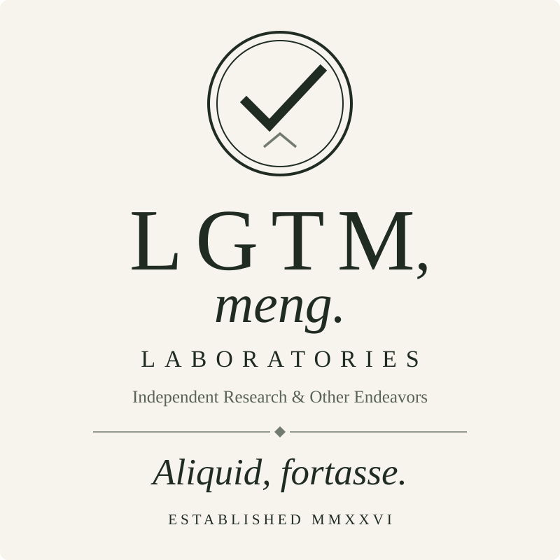

  

# John Tripodo

I work in tech and have been spending some of my free time using ChatGPT, Claude, and Codex to explore different research problems.

I've been working on quite a few things across mathematics, computer science, quantum information, circuit optimization, and other areas. It's been a lot of fun, and I'm hoping some of the work can contribute something useful.

AI does much of the actual research, coding, proof development, and testing. I help choose the problems, guide the work, and decide what to pursue and publish.

A few projects I've made public:

- [Erdős #670: Separated distances](https://github.com/jjtripodo-lgtm/erdos-670-fixed-dimension)
- [Erdős #708: Exact small cases](https://github.com/jjtripodo-lgtm/erdos-708-g4-g5)
- [C(13,7,4): Covering designs](https://github.com/jjtripodo-lgtm/c13-covering-number)
- [Double Hall graph constructions](https://github.com/jjtripodo-lgtm/double-hall-optimal-degree)
- [Sparse determinant bounds](https://github.com/jjtripodo-lgtm/sparse-projective-plane-determinants)
- [EPFL VOTER circuit optimization](https://github.com/jjtripodo-lgtm/epfl-voter-980-proof)

The repositories have more details on the results, verification, assumptions, and limitations. Much of the work hasn't been independently reviewed by human experts.

I'm happy to hear feedback, corrections, or ideas from anyone interested.

[ORCID](https://orcid.org/0009-0006-9180-4953)
